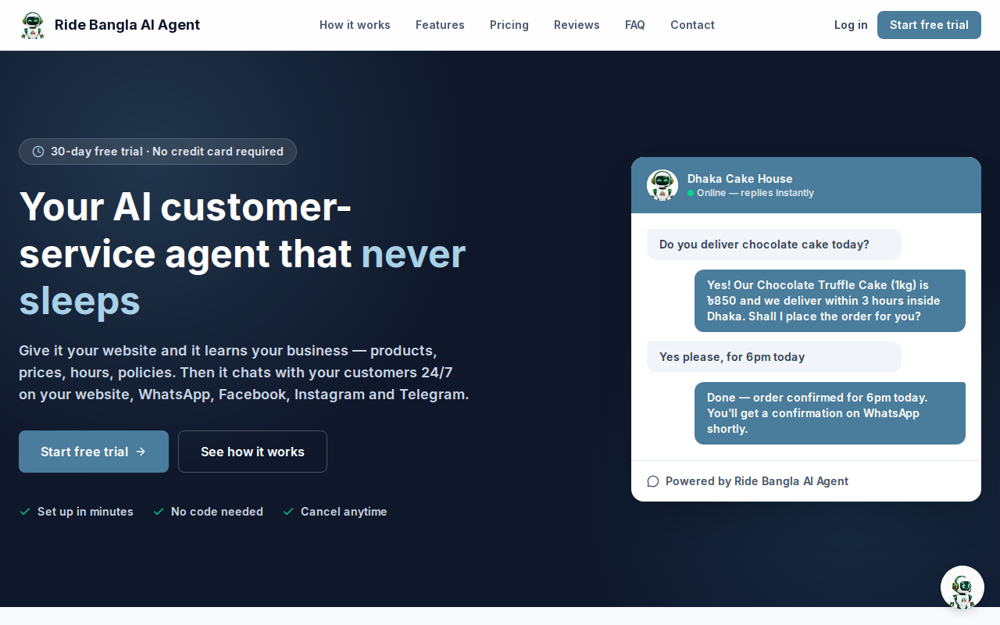
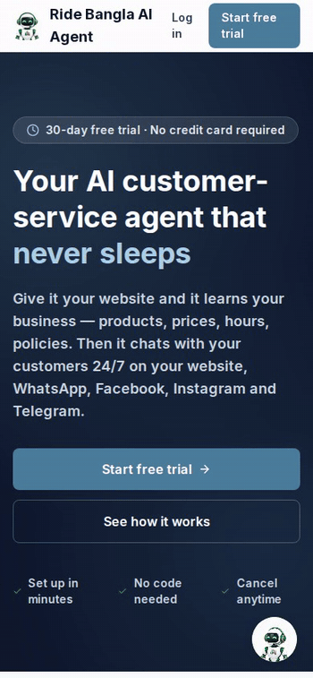
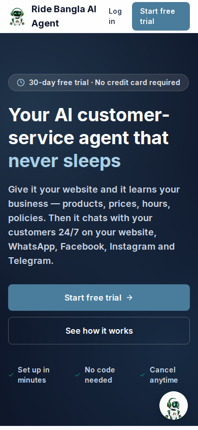
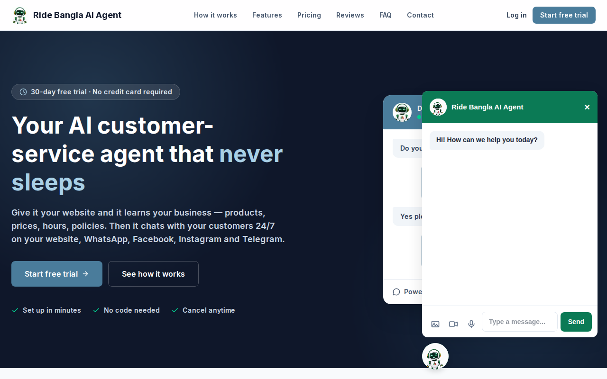
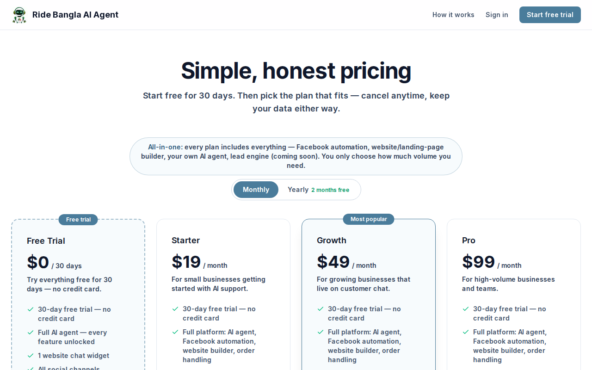
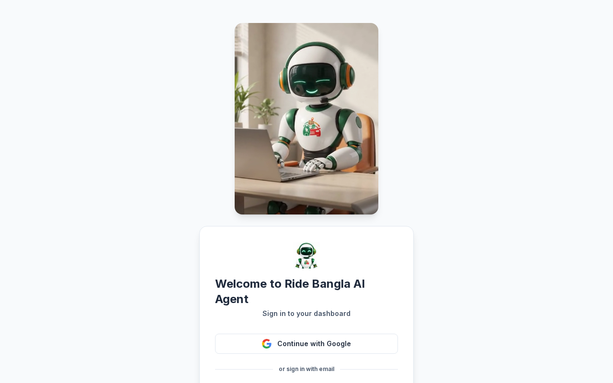

  

<h1 align="center">Ride Bangla AI Agent</h1>

  <strong>One AI agent for your whole business — it learns your websites, answers your customers on every channel, takes orders, and hands serious problems to a human on your team.</strong>

  
  

  

  

Live demo — recorded from the live site at ai.ridebangla.bd on 24 October 2026 (phone viewport): hero → setup steps → features → the chat widget opened to its greeting. No chat message was sent for this recording.

> **Service status:** the platform is live at [ai.ridebangla.bd](https://ai.ridebangla.bd). Live answer capacity is currently being upgraded (data-store quota and AI-provider budget), so the public widget may temporarily return an apology instead of a full answer. Everything below describes the product as it is built and evidenced in this repository — not a roadmap.

---

## About

**Ride Bangla AI Agent** is the multi-tenant AI customer-support platform of the Ride Bangla ecosystem, built and operated by **Ride Bangla Limited** (Faridpur, Bangladesh).

A business signs up, connects its website(s), and gets its **own** agent — carrying that business's name, knowledge, products and tone — working on its website and messaging channels around the clock. The agent *is* the help centre: there is no separate help system. When a customer has a serious problem or asks for a human, the agent creates a support ticket itself and a human continues **in the same conversation** from the business's inbox.

Ride Bangla's own business runs on this same platform. Company accounts sit outside the plan and limit machinery entirely — always free, no caps — and the platform admin can grant the same free access (a “comp”) to any business, with a plan, a duration and a reason.

---

## How it works

| Step | What happens |
|---|---|
| **1 · Connect your business** | Add one website — or as many as you have, one row at a time with the **+** control. No website? You can apply for website creation by the Ride Bangla IT Team from the same area, as a separate service. |
| **2 · The agent learns** | The platform ingests your sites into a per-business knowledge base (pages, products, prices, hours, policies, FAQs). You can also add and edit knowledge entries directly — edits reach the very next conversation. |
| **3 · The widget answers customers** | One embed script (`public/widget/ride-bangla-chat.js`) puts the agent on any website. It answers from verified knowledge only, in the customer's language — and when it has no verified fact, it says so instead of inventing one. |
| **4 · Humans take over when it matters** | Serious problems and “talk to a human” requests become support tickets. Your team replies from the shared inbox, in the same thread the customer is already in. |

---

## Features

### The embeddable widget — one agent, every website

- A single canonical embed powers the chat on every Ride Bangla website and on tenant websites alike; installation is one `<script>` tag carrying the business's own site key. The widget also mounts on this platform's own public landing page.
- **Tenant white-label identity:** each business's agent presents itself as *that business* — its name, its brand, its knowledge — never as Ride Bangla. A central brand record (mascot, colours, name) can be updated once and propagates to every widget.
- Animated mascot states (idle / working video), voice input transcribed server-side, and a speaker control that reads each reply aloud in the reply's own language.
- The floating launcher can be dragged to a new spot so it never covers a page's own buttons — and it never breaks the host page.

### Knowledge that comes from *your* business

- **Multi-website ingestion:** a business with ten websites gets ten entries, and the agent learns from all of them.
- A full knowledge base in the dashboard — entries and categories you control — plus a knowledge test surface to check what the agent will say before customers hear it.
- **Live website browsing:** when a customer shares a link, the agent fetches and reads that page before answering. Browsed pages are treated as untrusted data behind a prompt fence, and the fetcher refuses private/internal addresses (SSRF-guarded).

### One inbox for every channel

- Channels evidenced in this repository: the **website widget, WhatsApp, Facebook Messenger, Instagram, Telegram, email, SMS and phone**, plus social engagement surfaces — all landing in **one conversation inbox with one customer memory** across channels.
- Webhook signatures are verified and **fail closed** when a channel secret is missing.

### Tickets & human handover

- The agent creates support tickets itself when a conversation needs a human; tickets carry status, priority and SLA rules, and the human continues in the same thread.
- Canned responses, automation rules, business hours and a team/departments structure keep a real support operation running behind the agent.

### Selling, not just answering

- **Product catalog:** the agent knows your products and prices and shows rich product cards in chat.
- **Order handling:** orders are taken conversationally and organised for the business; where a tenant has connected courier delivery, confirmed orders can flow to Ride Bangla riders in served areas — otherwise the confirmation goes directly to the shop owner.
- **Lead engine:** leads, campaigns and follow-ups are built into the same dashboard.

### Plans, limits & free access — honestly presented

- **30-day free trial** on signup, then **Starter $19/mo · Growth $49/mo · Pro $99/mo** (yearly = 10 months' price, 2 months free). A lapsed trial falls back to a permanent free tier with a small message allowance instead of a hard lockout.
- **The limit rule:** a finished limit never blocks sign-in. The dashboard opens normally; inside it, a popup says the limit is finished, when it resets, and shows the plans with an **Update your package** path. Only the work stops.
- **Comp / free grants:** the platform admin can comp any business into free access — per plan, with duration and reason, including feature scoping and a comp-request queue. Ride Bangla's own accounts are permanently outside the limit machinery.

### Language & manners

- Replies follow the customer's language — English by default, Bengali fully supported, with additional dashboard locales in the codebase (Arabic, German, Spanish, French, Turkish).
- Short, professional, moderator-style answers: answer the question, then stop. The agent never invents prices, hours or policies, and after a *successful* resolution it may ask a satisfied customer for a review — at most once, never after a negative interaction, and switchable off per business.

### Analytics & operations

- Analytics, an activity log, API keys and API documentation, outbound webhooks with delivery history, data export, and GDPR export/delete for customer records.

---

## Screenshots

### Live public pages — captured 2026-10-23

| | |
|---|---|
|  |  |
| **Landing — desktop** — the live public landing page at [ai.ridebangla.bd](https://ai.ridebangla.bd), captured 2026-10-23, with the platform's own chat widget bubble visible at the bottom right. | **Landing — phone** — the same live landing page in a phone viewport, captured 2026-10-23, widget bubble visible at the bottom right. |

| | |
|---|---|
|  |  |
| **Chat widget — panel open** — the widget opened from the landing-page bubble without signing in, captured 2026-10-23, showing its greeting “Hi! How can we help you today?”. No message was sent for this capture. | **Pricing — desktop** — the live public pricing page, captured 2026-10-23: Free Trial $0, Starter $19/mo, Growth $49/mo, Pro $99/mo. |

**Sign in — live** — the live public login page, captured 2026-10-23 (public page only; no sign-in was performed).

### Dashboard (demo tenant)

| | |
|---|---|
|  |  |
| **Sign in** — one login that persists on the device; sign-in is only asked again after sign-out, a password change or revoked access. | **Dark mode** — the full dashboard in the platform's dark theme. |

> The dashboard screenshots in this README are the repository's own product screenshots (`docs/screenshots/`), showing a demo tenant workspace branded “Owly” in the sidebar. The public-surface captures above (landing desktop and phone, widget panel, pricing and login) are fresh live captures from [ai.ridebangla.bd](https://ai.ridebangla.bd) taken on 2026-10-23; dashboard imagery remains the repository's demo-tenant set, because no sign-in was performed. No screenshot in this README is staged or fabricated.

---

## Tech stack

*From `package.json` in this repository — nothing more, nothing less.*

| Layer | Technology |
|---|---|
| Framework | Next.js 16.3.6 (App Router) |
| UI | React 19.2.4 · Tailwind CSS 4 · Radix UI · Lucide icons |
| Language | TypeScript 5 |
| Data & auth | Firebase — Cloud Firestore · Firebase Admin SDK 13.5 |
| Payments | Stripe 23 |
| Channels / messaging | Twilio 5 · WhatsApp Web.js · Nodemailer / IMAP |
| State & validation | Zustand 5 · Zod 4 |
| Testing | Vitest 4 |

---

## Security

Tenant isolation is enforced in the data layer: every read and write is scoped to the caller's business. Sessions use signed tokens in httpOnly cookies with device persistence, passwords are bcrypt-hashed, webhook signatures are HMAC-verified and fail closed, and browsed web content is SSRF-guarded and prompt-fenced.

Full policy, supported versions and how to report a vulnerability responsibly (never in a public issue): **[SECURITY.md](SECURITY.md)** · security contact: **support@ridebangla.bd**

---

## The Ride Bangla ecosystem

Ride Bangla AI Agent is one part of the Ride Bangla ecosystem — every service presents all the others, so a visitor for one discovers the rest:

| Service | Visit |
|---|---|
| Ride Bangla — main website | [ridebangla.bd](https://ridebangla.bd) |
| **AI Agent — AI customer-support SaaS (this project)** | [ai.ridebangla.bd](https://ai.ridebangla.bd) |
| Studio — AI media studio | [studio.ridebangla.bd](https://studio.ridebangla.bd) |
| Tools — free online tools | [tools.ridebangla.bd](https://tools.ridebangla.bd) |
| IT Team — web & software services | [it.ridebangla.bd](https://it.ridebangla.bd) |
| Customer app (web) | [customer.ridebangla.bd](https://customer.ridebangla.bd) |
| Partner app (web) | [partner.ridebangla.bd](https://partner.ridebangla.bd) |
| Rider app (web) | [rider.ridebangla.bd](https://rider.ridebangla.bd) |
| Agent app (web) | [agent.ridebangla.bd](https://agent.ridebangla.bd) |

**Leadership:** Enamul Seddik (Co-Founder & CEO) · Emon Seddik (Co-Founder & Director) · Obayedur Rahman Shaikh (Co-Founder & Marketing Director) · Tabassum Nisha (Director, IT Team)

---

## Contact & community

- **General:** info@ridebangla.bd · **Support:** support@ridebangla.bd
- **Community:** [Ride Bangla Community on Facebook](https://www.facebook.com/share/g/1CfmiTzv1D/)

  &nbsp;
  &nbsp;
  &nbsp;
  &nbsp;
  &nbsp;
  

Facebook · X · Instagram · Threads · TikTok · YouTube — follow **Ride Bangla** for product news and releases.

---

## License

Proprietary software of **Ride Bangla Limited** — all rights reserved. No part of this software may be copied, modified, distributed or used without the prior written permission of Ride Bangla Limited, except where a separate signed agreement expressly permits it. Third-party components remain under their own licenses.

Full text: **[LICENSE](LICENSE)**
