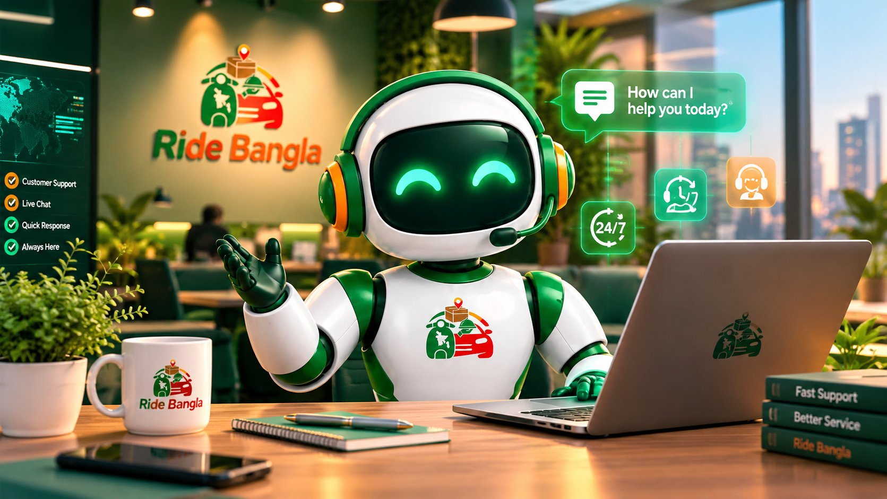

<p align="center">
  
</p>

<h1 align="center">🤖 Ride Bangla AI Agent</h1>

<h3 align="center">
  AI Customer Support &amp; Social Automation SaaS
</h3>

<p align="center">
  <strong>Production • Multi-tenant • ai.ridebangla.bd</strong>
</p>

<p align="center">
  One AI agent for your business — website widget • WhatsApp • Facebook • Instagram • Telegram • Email
</p>

<p align="center">
  
  
  
  
  
  
</p>

<p align="center">
  
</p>

---

## 📖 About

**Ride Bangla AI Agent** is the multi-tenant AI customer-support platform of the
Ride Bangla ecosystem. Any business can sign up, teach the agent from its own
knowledge base and websites, and put the same agent to work on its website and
social channels — answering customers in **English (default) or Bengali**, in a
short, professional, moderator-like style.

The agent **is** the help center: there is no separate help system anywhere.
When a customer has a serious problem or asks for a human, the agent creates a
support ticket itself and a human continues in the same conversation from the
Admin Panel.

Ride Bangla's own business runs on this platform like every tenant — with one
difference: the company's own accounts sit outside the plan/limit machinery
entirely (always free, no caps).

---

## ✨ Features

### 💬 Chat engine

- **Streaming replies** (SSE) with a strict typing lifecycle: the typing
  indicator exists only while a request is genuinely in flight before the
  first token, and never re-appears at the end of a turn.
- **Provider chain with circuit breakers** — Groq first (default model
  `openai/gpt-oss-120b`, with an automatic model fallover chain), Gemini and
  OpenAI legs coded; a failing provider is skipped fast instead of stalling
  every reply, and rate-limit responses never poison the breaker.
- **Tool loop with salvage** — if a tool-using turn fails after doing real
  work, the engine retries once with a smaller, tool-less completion instead
  of discarding the work for a generic failure message.
- **Token discipline** — capped tool results, capped history and output, so
  one conversation turn stays inside provider token-per-minute ceilings.
- Per-stage latency and token logging on every turn.

### 🧩 The canonical widget

- One embed (`public/widget/ride-bangla-chat.js`, currently
  **v2026-10-22.9**) powers the chat on **every** Ride Bangla website and on
  tenant websites — install is a single `<script>` tag with the business's
  site key.
- Animated mascot brand (idle / working video states follow the same
  in-flight law as the typing indicator).
- **Voice input** — tap the mic, speak, the message is transcribed server-side
  (Whisper) and sent; permission problems render as a subtle system notice,
  never as a fake agent reply.
- **Voice playback** — every agent reply has a speaker control that reads it
  aloud in the reply's own language (browser speech synthesis; hidden where
  speech is unavailable, never autoplay).
- Paused-subscription businesses get an honest paused state; the widget never
  breaks a host page.

### 📚 Knowledge & website browsing

- Per-business knowledge base (entries, categories, FAQs) — edits reach the
  very next conversation.
- **Multiple websites per business** — add as many as you have (one input +
  plus button); the agent learns from all of them. No website? A business can
  apply for website creation by the Ride Bangla IT Team from the same area.
- **Live website browsing** — when a customer shares a link, the agent fetches
  and reads the page before answering. Browsed content is treated as
  untrusted data behind a prompt fence, and the fetcher refuses private /
  internal addresses (SSRF-guarded).

### 📨 Channels

- Website widget, WhatsApp, Facebook Messenger, Instagram, Telegram and
  email — one inbox, one customer memory across channels.
- Webhook signatures are verified (HMAC, timing-safe) and fail closed when a
  channel secret is missing.

### 🎫 Help center & tickets

- The agent answers, persuades honestly from verified knowledge, and never
  invents prices, hours, delivery areas or policies — when it has no
  verified fact it says so and offers the next step.
- Support tickets are created by the agent itself and flow to the Admin
  Panel; agents can ask a satisfied customer for a review (at most once,
  never after a negative interaction, switchable per business).

### 💳 Plans & billing

- 30-day free trial on signup; Free / Starter / Growth / Pro plans from the
  live plan catalogue.
- Stripe checkout plus manual payment claims (US bank transfer, Binance Pay,
  Bybit, OKX) with **copy buttons on every payment detail** and a visible
  "Copied" confirmation, automatic exchange-based verification, and a human
  review queue in the Admin Console for anything uncertain. One transaction
  id can only ever activate one subscription.
- **Limit-UX law:** when a plan's usage limit runs out, login still works —
  only the work stops. Inside the dashboard a bar and popup say the limit is
  finished, when it resets, and show the plans with an **Update your
  package** path.

### 🔒 Security & tenant isolation

- Tenant isolation is enforced in the data layer itself: every read/write is
  scoped to the caller's business, and ownership is proven before updates
  and deletes.
- API keys are admin-only and never logged; sessions persist on the device
  (sign in once — legitimate re-login only on sign-out, password change or
  revoked access).
- Full security pass in every audit round (auth/session, webhooks, SSRF,
  injection battery against browsed content).

### 🗣️ Language & reply style

- **Default language is English; the active language stays pure** — the
  customer's latest message decides (English in → English out, Bengali in →
  Bengali out).
- Short, warm, professional replies: answer the actual question and stop —
  no brochure dumps, no unasked contact details, no plan catalogue unless
  plans were asked about.
- Unknown visitors are addressed as **স্যার/ম্যাডাম**; the agent never quotes
  fare figures (fares are distance-based and confirmed at order time).

---

> ## 📌 Current Status — Re-audit #2 (2026-10-22)
>
> ### Recently completed
>
> - Latency programme F1–F7: parallelised engine prep, capped tool results
>   and completions, greeting fast path, tool-loop salvage, provider
>   breaker corrections (rate limits no longer trip the breaker).
> - Widget embed v2026-10-22.7: typing-lifecycle fix, voice-input
>   permission flow + system notices, voice playback on every reply.
> - Widget embed v2026-10-22.8: compose box is now an auto-growing
>   textarea (Enter sends, Shift+Enter inserts a new line); identity
>   fast path — "তুমি কে" gets a short professional self-introduction
>   instead of the full pipeline; session refresh rotation grace (a
>   second tab restoring with the just-rotated token no longer ends
>   the session; sign-out and revocation behaviour unchanged).
> - Widget embed v2026-10-22.9: Help Center inline parity — the status
>   strip no longer repeats the typing bubble's generic caption (one
>   animated typing indicator per turn; the strip speaks only when the
>   server reports a specific activity).
> - Login loading: the dashboard layout's serial session/config reads
>   were parallelised (the last two now resolve together); the
>   revocation read is deliberately never cached.
> - Reply style v2 (short moderator style) + empty-knowledge grounding fix
>   (the agent no longer asserts facts it has no source for).
> - Tenant journey fix: the Channels page install snippet now resolves the
>   tenant's own site key (it previously rendered empty for every tenant).
> - Billing: WeChat Pay removed entirely; copy controls on every payment
>   detail; tenant-dashboard limit-UX independently verified (login
>   untouched; company / Super Admin exempt).
> - SEO verified complete for the global market (per-page metadata,
>   canonical, OpenGraph/Twitter, JSON-LD, sitemap, robots).
> - Project cleanup: zero-reference scaffold assets removed.
>
> ### Remaining / owner decisions
>
> - Production currently serves the Phase B/C build (embed
>   v2026-10-22.7). Pushed but not yet deployed (Vercel daily
>   deployment cap): project cleanup, the login-loading fix, and
>   Phase H (embed v2026-10-22.8, identity fast path, session
>   rotation grace) — live re-verification follows the deploy.
> - Gemini provider leg is coded; it activates when a Gemini API key is set
>   on this Vercel project (owner-side).
> - Daily/hourly product limits do not exist yet (only the 30-day plan
>   period gate) — a separate product build, owner's call.
> - The dashboard knowledge-test endpoint spends LLM tokens without a limit
>   gate — gating it needs the owner's authorization.
> - Real-device checks still open: phone microphone capture and speech
>   playback, Google sign-in end-to-end, exhausted-account popup on a real
>   phone.

---

## 💻 Technology Stack

| Layer | Technology |
|---|---|
| Framework | Next.js 16 (App Router) |
| UI | React 19, Tailwind CSS 4 |
| Language | TypeScript 5 |
| Database / Auth | Firebase — Cloud Firestore, Firebase Admin SDK |
| AI providers | Groq, Gemini, OpenAI (per-business keys supported) |
| Payments | Stripe + manual claims with exchange verification |
| Voice | Server transcription (Whisper) + browser speech synthesis |
| Tests | Vitest (900+ tests) |
| Hosting | Vercel (project `ride-bangla-ai-agent`) |

---

## 📂 Project Structure

```text
src/
├── app/            # Pages + API routes (dashboard, widget, billing, auth)
├── components/     # Dashboard and billing UI
├── lib/            # Engine, providers, billing, channels, security
└── middleware.ts   # Session + security headers
public/
├── widget/         # The canonical embed (ride-bangla-chat.js)
└── agent-*.png/mp4 # Mascot brand assets served to every surface
tests/              # Unit, API and attack batteries
docs/               # API + operations documentation
```

---

## 🚀 Development

```bash
npm ci
npm run dev        # http://localhost:3000
npm test           # vitest suite
./node_modules/.bin/tsc --noEmit
```

Configuration is via environment variables and per-business settings in the
dashboard (provider keys, channel credentials). See `OPERATIONS.md` and
`docs/` for the runbooks.

---

## 📄 License

Copyright © Ride Bangla Limited.

This repository contains proprietary software and confidential business
logic. Unauthorized copying, redistribution, modification, or commercial
use is prohibited without written permission from Ride Bangla Limited.

All rights reserved. See `LICENSE`, `SECURITY.md` and `CONTRIBUTING.md`.

---

<p align="center">
  <strong>Ride Bangla AI Agent</strong><br/>
  The agent is the help center — on every site, in every channel.
</p>
